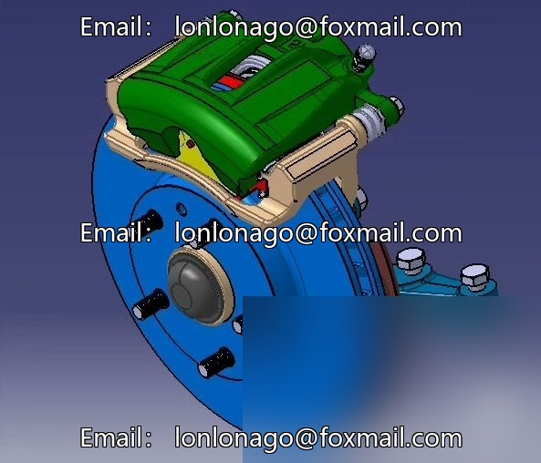
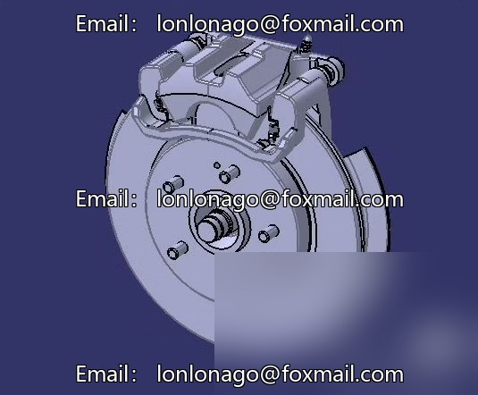
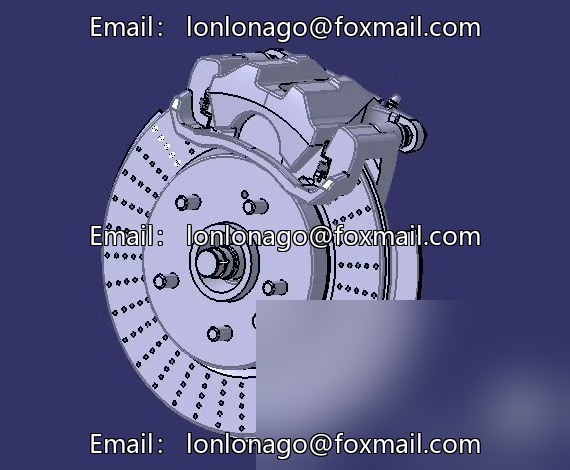
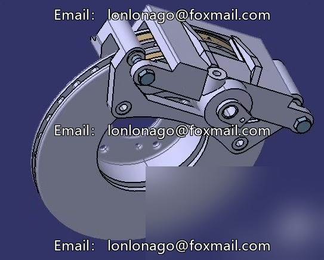
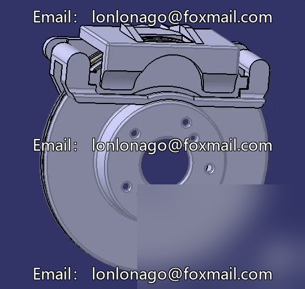

# Pan-type brake actuator structure design

## Body

Plate brake design structure, brake design, plate brake design, plate brake design parameters/model, plate brake 3D, plate brake data model, ventilation plate brake design 3D diagram
Additionally, design can be customized according to your needs
Contains several data
Can be opened and edited with CATIA UG SolidWorks and other software
A015 has other various 3D drawings, details can be discussed specifically

The content covers design structure, data model, 3D diagrams and data models for a disc brake, and mentions that Catia, UG SolidWorks and other tools can be used for opening and editing, with custom design service available.

<!-- AI_ENRICHED -->

## Images

## Payment

Here is a pay link on Stripe ( https://buy.stripe.com/3cs8yP7sY87d0vu9AB ). Please contact me lonlonago@foxmail.com after funding $89, and I will send you a complete data files , thank you!

